<div align="center">

# Watermarking LLMs

### A reproduction of *A Watermark for Large Language Models* (Kirchenbauer et al., ICML 2023), and extensions

MFE 230ZB – Generative AI and Causality · UC Berkeley MFE · Fall 2026

Instructor: Prof. Ali Kakhbod

**Piero Pelosi, Romain Almeida, Elias Roubache**

[Paper](https://arxiv.org/abs/2301.10226) · [Official code](https://github.com/jwkirchenbauer/lm-watermarking) · [Report](report/main.pdf) · [Presentation](presentation/main.pdf) · [Notebook](watermark.ipynb)

</div>

---

## Live demo

<p align="center"><a href="https://pieropls.github.io/230ZB/presentation/watermark-live.html">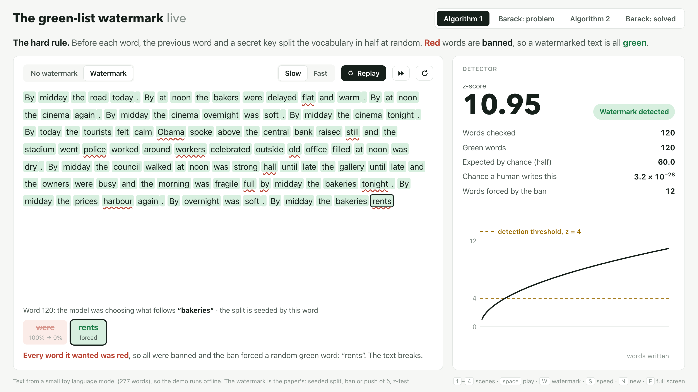</a></p>

<p align="center"><b><a href="https://pieropls.github.io/230ZB/presentation/watermark-live.html">Open the live demo</a></b> · one page in your browser, nothing to install</p>

The page writes a text one word at a time and runs the detector as it goes. Four tabs:

| tab | what it shows |
|---|---|
| **Algorithm 1** | The hard rule. Before each word, the previous word and a secret key split the vocabulary in half; red words are banned. Press Play and watch the z-score cross 4. Switch to *No watermark*: it stays near 0. |
| **Barack: problem** | After "Barack" the model is 96% sure of "Obama". If the key makes "Obama" red, the ban forces a word the model barely wanted. Try *New key*. |
| **Algorithm 2** | The soft rule. Nothing is banned: green words get a bonus δ (slider). Where the model hesitates, green wins; where it is sure, almost nothing changes. |
| **Barack: solved** | Same red "Obama": the push only lowers it from 96% to 92%, so the sentence survives. |

The words come from a small toy language model (277 words), so the page works offline. The watermark itself is the paper's: seeded split, ban or push, z-test. Keys: 1–4 tabs, space play, W watermark on/off, S speed, N new text, F full screen.

---

## In short

- **The paper.** A model can sign its own text. While writing, it favours a secret half of the vocabulary that changes at every word. Anyone with the key counts these "green" tokens and runs a z-test, without the model, its API or the prompt.
- **Reproduction.** With our own code on the paper's setup:
  - 98.6% of watermarked texts are detected at z = 4 (paper: 98.4%), and none of 1,000 human texts is flagged.
  - 11 of 12 error-rate settings (Table 8) match within our 95% intervals.
  - Our green lists are identical to the official code.
- **Extension 1, entropy decides.** News is detected after a median of 24 tokens, code after 188 (49% of functions never within 200 tokens), and short factual answers never.
- **Extension 2, a 2026 attacker.** One prompt to a free 1.5B chat model removes more of the watermark than the paper's T5 attack at the same meaning kept. Still detected at 1% false positives: 43.5% after the rewrite, against 81% after T5.
- **Extension 3, copy-paste.** Take a 60-token watermarked passage inside a 600-token human text. The whole-text test catches it 11.5% of the time; a sliding window (WinMax, from the authors' follow-up) catches it 86.5% of the time.
- **Extension 4, a side effect of the key.** Under our key, the watermark makes texts stop early: 16% end before 50 tokens, against 6% without it.
- **Extension 5, the watermark as a filter for sentiment data.** If an attacker adds watermarked AI texts to a sentiment feed, dropping the texts flagged at z = 4 undoes 95% of the damage for 200-token texts, 40% at 50 tokens and 7% at 25 (where z cannot exceed 5); a full paraphrase brings it under 1%, and AI text without the watermark is untouched. Recovery equals the detection rate to within 0.03: the texts that escape are not a special sample by sentiment.

Square brackets below are 95% intervals: Wilson for rates, bootstrap for medians. [RESULTS.md](RESULTS.md) has every table in full. [presentation/NUMBERS.md](presentation/NUMBERS.md) traces every number on the slides to its source.

---

## The paper in brief

**Why a watermark.** Classifiers that guess "human or AI" from style have no guaranteed error rate, and they get worse as models improve. OpenAI's AI Text Classifier (January 2023) caught 26% of AI text and flagged 9% of human text. It was withdrawn in July 2023. A watermark is put in on purpose while the model writes, so the test knows exactly what to look for. In the paper, 98.4% of watermarked texts are detected at z = 4, and the test fixes the false-alarm rate at about 3 in 100,000.

### Algorithm 1: ban half the vocabulary

**Generation** (needs the model and the key):

0. **Tokenize.** Prompt and text become token ids (for OPT, integers from 0 to 50,264).
1. **Run the model.** It gives a probability to each of the 50,265 tokens, as any LLM does. Nothing changes here.
2. **Hash.** A function of the secret key and the *previous* token's id returns a seed. In the official code, seed = 15,485,863 × id. For the first word, the previous token is the last token of the prompt.
3. **Random split.** A pseudo-random generator started from that seed splits the whole vocabulary into a green half and a red half. The split looks random, but the same seed always gives the same split.
4. **Ban and draw.** Red tokens get probability 0. The next token is drawn from the green ones.
5. **Loop.** The new token becomes the previous token. Go back to step 1.

**Detection** (needs only the text and the key):

0. **Tokenize** with the same tokenizer.
1. **Rebuild the splits.** For each token, hash the previous token with the key, rebuild the same split, and read the token's colour. This works on any slice of the text.
2. **Count** the green tokens: $|s|_G$ out of $T$.
3. **Test.** $H_0$: the writer did not know the lists (a human, or another model). Then each token is green with probability 1/2, so $|s|_G \sim \mathrm{Binomial}(T, 1/2)$ and

$$z = \frac{|s|_G - T/2}{\sqrt{T}/2}.$$

If $z > 4$, we reject $H_0$: the text is watermarked. A human text gets there with probability $3.2 \times 10^{-5}$.

An all-green text has $z = \sqrt{T}$, so 16 green tokens already reach $z = 4$. Editing one token turns at most two tokens red: itself, and the next one, whose split it seeds. So 200 edits on 1,000 tokens still leave $z \approx 6.3$.

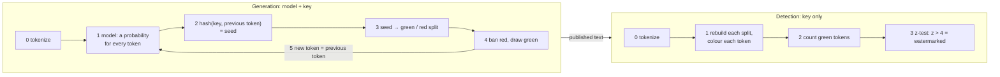

### Algorithm 2: push instead of ban

The ban breaks where the model has no real choice. After "Barack" the model puts almost all its probability on "Obama". If "Obama" is red, the ban forces "Hussein" or "and". Code and memorised quotes behave the same way. A human would write the same thing there anyway, so these tokens prove nothing, and forcing a different one wrecks the text.

Algorithm 2 keeps every token allowed and adds a bonus $\delta$ to the logits of the green tokens, a share $\gamma$ of the vocabulary:

$$\hat p_k = \frac{\exp\big(l_k + \delta \cdot \mathbf{1}[k \in G]\big)}{\sum_i \exp\big(l_i + \delta \cdot \mathbf{1}[i \in G]\big)}.$$

A green token's odds are multiplied by $e^\delta$ (×7.4 at δ = 2). Where the model hesitates, green wins; where it is sure, almost nothing changes. Detection is the same count, with $\gamma$ in place of 1/2:

$$z = \frac{|s|_G - \gamma T}{\sqrt{T\gamma(1-\gamma)}}.$$

The price is that the signal now comes only from tokens where the model had a choice. Theorem 4.2 makes this precise. Let $S^\ast$ be the average spike entropy along the text, a measure of how spread the model's next-token probabilities are. Then

$$\mathbb{E}|s|_G \ge T \cdot c \cdot S^\ast,$$

with $c = 0.88$ at γ = 0.5, δ = 2. In the paper's main setting the bound gives at least 142.2 green tokens out of 200 on average; 159.5 are observed. Low-entropy text such as code or short answers therefore carries little watermark. That is Extension 1.

The idea has reached production. In August 2026 Anthropic [announced](https://www.anthropic.com/news/claude-text-watermark) that Claude will watermark its text with a version of SynthID-Text, a scheme from the same family. The announcement says the watermark is less reliable on short, factual or code text.

---

## What we did

### Reproduction

We ran the same experiments as the paper with our own code:

- C4 news prompts, with OPT-1.3B writing at temperature 0.7 and texts of 200 ± 5 tokens.
- OPT-2.7B as the quality judge.
- The T5-Large word-swap attack, rebuilt from the paper's description because its code was never released.

The full run took about 20 hours on one laptop (Apple M5 Pro, 24 GB). First check: our green lists are identical to the official code on 1,000 random contexts (200 for Qwen).

Main setting (γ = 0.5, δ = 2, T = 200; 497 watermarked texts, 1,000 human texts):

| | paper | ours |
|---|---|---|
| detected at z = 4 | 98.4% | 98.6% [97.1, 99.3] |
| human texts flagged | 0 | 0 of 1,000 |
| mean green tokens (of 200) | 159.5 | 158.3 [157.5, 159.2] |
| Theorem 4.2 lower bound | 142.2 | 143.2 |
| detected at z = 4, 4-beam search (150 texts) | 99.6% | 100% [97.5, 100] |

<p align="center">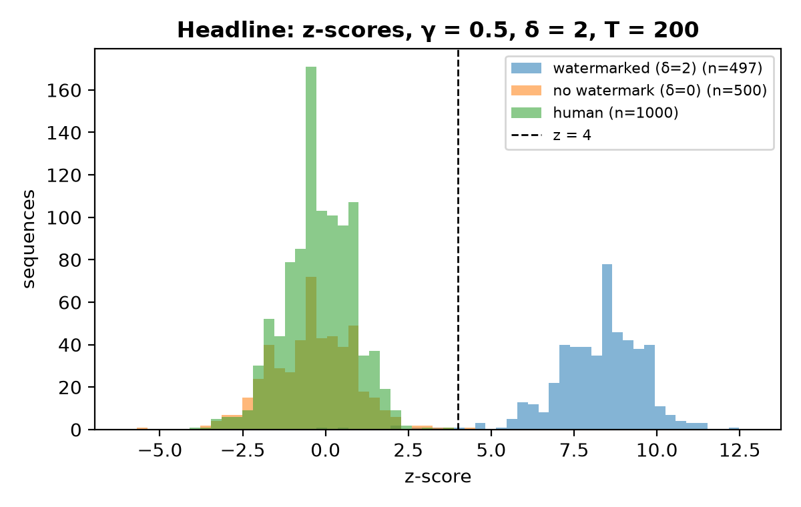</p>

Across Table 8's 12 settings of δ, γ and decoding, 11 match the paper within our 95% intervals. Against the T5 attack (Table 9) the curves have the same shape: from 30% of words swapped on, our numbers agree with the paper's or come close. The paper's Fig. 2 points (strength against quality) were digitised from the vector PDFs in its arXiv source (`digitize_fig2.py`): over the 31 settings present in both, our mean z is within 0.78 of the paper's everywhere (median gap 0.22), and perplexity sits 0.2 to 1.0 above the paper's at every δ including 0, so that offset comes from the oracle run, not from the watermark.

<p align="center">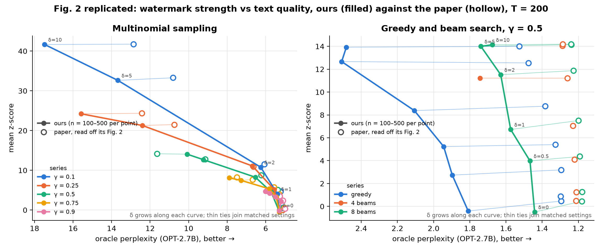</p>

What we could not reproduce:

- **One weak-push setting detects less.** Multinomial sampling, δ = 1, γ = 0.5: 0.37 [0.31, 0.42] detected at z = 5, against the paper's 0.50. It may depend on the key; we did not test this.
- **The lightest T5 attack removes less.** At 10% of words swapped, 0.99 is still detected at z = 4, against 0.82.
- **Perplexities are slightly higher**, by about 0.1 to 0.3 under multinomial sampling (by 1.7 in one setting, δ = 5 and γ = 0.25), with the same ordering everywhere.
- **Short answers.** OPT-1.3B cannot do the task, so we used Qwen2.5-1.5B-Instruct. The watermark costs no measurable accuracy (exact match 0.202 → 0.212).

### Extensions

The paper leaves four questions open. Each extension takes one:

| open question | why it matters | extension |
|---|---|---|
| constrained text (code, short answers) | little choice, little signal | 1 |
| a modern rewrite | the paper attacks with T5 word swaps (2020) | 2 |
| a watermarked passage pasted into human text | listed as open in the paper's conclusion | 3 |
| side effects of the key itself | the key fixes the colour of every token pair, "stop" included | 4 |

**Extension 1: entropy decides.** The push only acts where the model has a choice, so constrained text should carry less signal. This is Theorem 4.2's own prediction. Median tokens to reach z = 4 with OPT-1.3B:

- **News** (γ = 0.25, δ = 2): 24 [20, 27].
- **Code** (same settings): 188 [135, never]. 49% of functions never reach z = 4 within 200 tokens.
- **Short factual answers** (TriviaQA, greedy, γ = 0.5 as in the paper's Table 10): never, in 99% of cases. At γ = 0.5, a fully green 16-token answer only reaches z = 4 exactly.

Instruction tuning lowers the model's entropy, yet news detection is unchanged: at 1% false positives, 0.990 of texts are detected for Qwen2.5-1.5B-Instruct and 0.995 for its base model. The cost moves to quality instead: the watermark raises the instruct model's perplexity from 5.67 to 9.55.

<p align="center">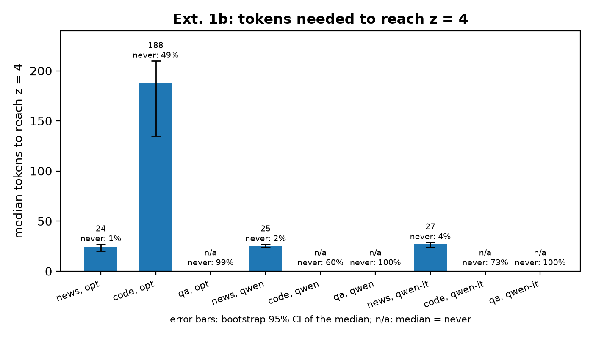</p>

**Extension 2: a 2026 attacker.** The watermark lives in pairs of neighbouring tokens. A word swap breaks few pairs; a rewrite breaks most. We attacked the same watermarked texts in two ways: with the paper's T5 swaps, and with one prompt to Qwen2.5-1.5B-Instruct. False positives are calibrated on human texts attacked the same way. "Meaning kept" is the cosine similarity of sentence embeddings, original vs attacked.

| attack | meaning kept | detected at 1% false positives | AUC | model calls |
|---|---|---|---|---|
| T5, 30% of words swapped | 0.856 | 81% | 0.995 | 60 to 140 |
| Qwen, light rewrite | 0.850 | 43.5% | 0.881 | 1 |
| Qwen, full rewrite | 0.837 | 10% | 0.705 | 1 |

Removing the watermark still costs meaning, but it now takes one prompt to a free model.

<p align="center">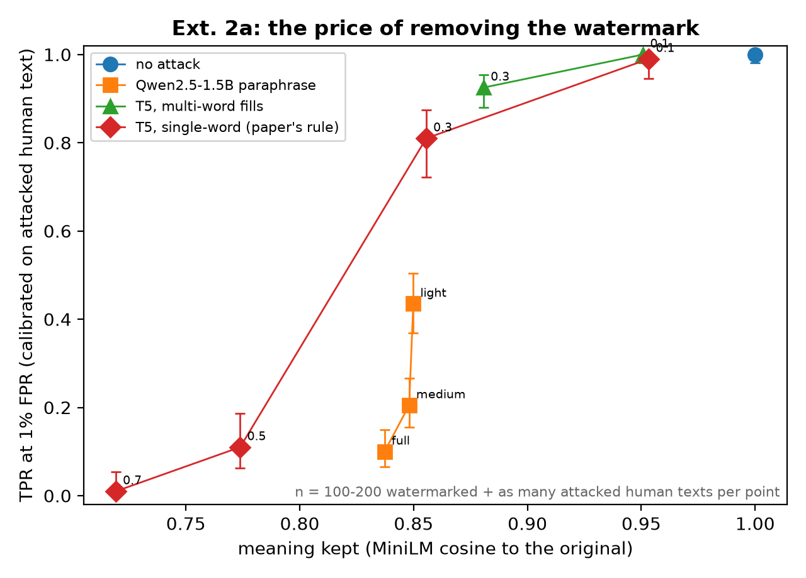</p>

**Extension 3: copy-paste.** We hid one watermarked passage inside a 600-token human document, with thresholds set for 1% false positives on 1,000 human-only documents. Counted over the whole text, the human tokens pull the score back toward chance. A sliding window (WinMax, from the authors' ICLR 2024 follow-up) restores the contrast.

| watermarked share | whole-text count | sliding window (WinMax) |
|---|---|---|
| 10% (60 tokens) | 11.5% | 86.5% |
| 25% (150 tokens) | 81.5% | 99.5% |
| 50% (300 tokens) | 100% | 100% |

<p align="center">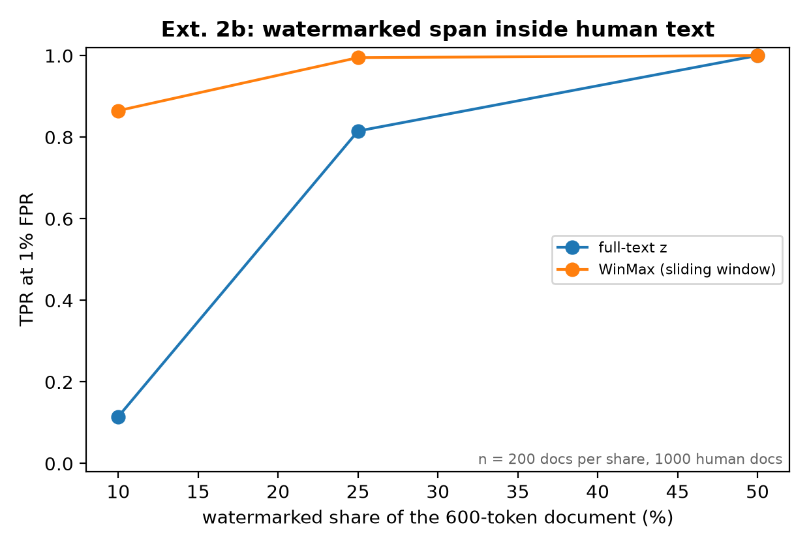</p>

**Extension 4: the key can change when the model stops.** Under our key, after a period the end-of-text token is green, while newline, the usual next token, is red. At δ = 2 this multiplies the chance of stopping by about 2.3. As a result, 16% [14, 18] of watermarked texts end before 50 tokens, against 6% [4, 7] without the watermark. Under three other keys the multiplier is 0.17, 1.18 and 0.32, and text lengths look normal. The paper keeps only texts of 200 ± 5 tokens, which hides this effect.

<p align="center">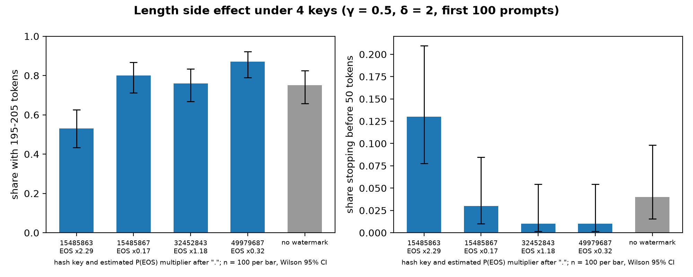</p>
<p align="center">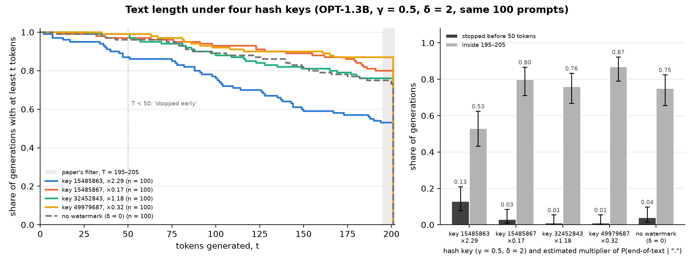</p>

**Extension 5: the watermark as a filter for sentiment data.** A sentiment signal is built from many texts; some are written by a model to push it. We build buckets of 50 human news texts (FinBERT score, truth = the bucket's human mean), add slanted watermarked texts to half of them (share c = 0.1 or 0.3, the top or bottom third of the AI pool by sentiment), and measure how much of the damage is undone by removing the texts the detector flags, between the no-filter and perfect-filter bounds. 500 re-draws; the simulation runs in seconds from a per-text table (`python run.py ext3`). No new text was generated: every AI text comes from the earlier extensions.

| AI texts | tokens | detection at z = 4 | recovery, c = 0.3 | predicted from the detection rate |
|---|---|---|---|---|
| watermarked | 25 | 0.103 | 0.071 [0.051, 0.089] | 0.071 |
| watermarked | 50 | 0.533 | 0.397 [0.361, 0.434] | 0.417 |
| watermarked | 100 | 0.939 | 0.868 [0.836, 0.896] | 0.895 |
| watermarked | 200 | 0.986 | 0.954 [0.938, 0.973] | 0.976 |
| light paraphrase | 151 | 0.220 | 0.149 [0.130, 0.167] | 0.169 |
| full paraphrase | 178 | 0.015 | 0.006 [0.004, 0.008] | 0.011 |
| no watermark | 200 | 0.002 | 0.000 | 0.000 |

Recovery follows the detection rate (the prediction removes the same number of AI texts at random, so it assumes escaping is unrelated to sentiment; the gap is at most 0.03 and never significant). What the earlier extensions measured as lost detection, short texts and paraphrase, is lost signal quality one for one; a model that does not embed the watermark is invisible. A threshold calibrated to 1% false positives lifts the 25-token recovery from 0.07 to 0.63 at the cost of 20 human texts in 5,000, and on 60-token passages pasted into human documents the sliding-window detector recovers 0.66 where the whole-text test recovers nothing. The campaign is synthetic (we inject the texts), so this is the value of the filter if providers embed the watermark, not evidence about real feeds.

<p align="center">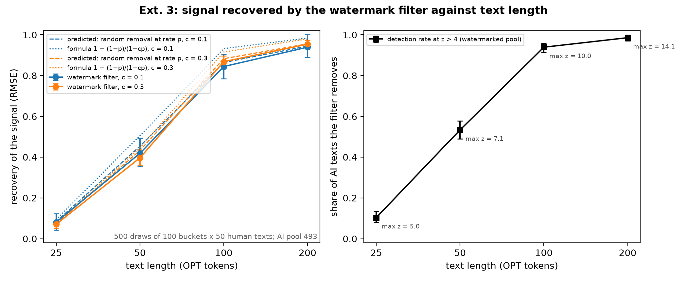</p>

Extension numbers follow the presentation. RESULTS.md, the notebook and the figure files use the earlier labels: Extension 1 = 1a–1c, Extension 2 = 2a, Extension 3 = 2b, Extension 4 = the key and length check, Extension 5 = `ext3_filter` (its spec, plan and handoff: `SPEC_ext3_filter.md`, `PLAN_ext3.md`, `HANDOFF_ext3.md`).

---

## How the pipeline works

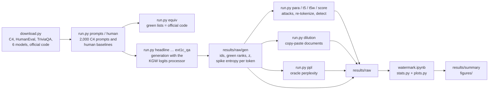

Every generated row stores the green rank of each token rather than a 0/1 flag. The same generations can then be rescored for any γ, ignoring repeats, or over any prefix length, without touching the model again. The notebook only reads `results/raw/` and rebuilds every table and figure.

| file | role |
|---|---|
| `params.py` | every knob and every experiment grid (plain dicts and lists) |
| `core.py` | data, models, the watermark logits processor, generation, detection, perplexity, T5 and paraphrase attacks |
| `stats.py` | z-scores, ROC/AUC, TPR at fixed FPR, Theorem 4.2 bounds, Wilson and bootstrap intervals |
| `plots.py` | one function per figure (matplotlib) |
| `run.py` | command line for every step: `python run.py list` |
| `watermark.ipynb` | loads the results, builds every table and figure, shows them next to the paper's |
| `ext3.py` | Extension 5: bucket simulation, recovery and its predictions, from the per-text table (numpy, seconds) |
| `digitize_fig2.py` | reads the paper's Fig. 2 points out of the vector PDFs in its arXiv source (needs `pymupdf`; output already in `results/summary/fig2_paper.csv`) |
| `download.py` | data, models and the official code (pinned commit) |
| `presentation/main.tex`, `main.pdf` | the class slides (beamer; compiles on Overleaf) |
| `presentation/make_figures.py` | every slide figure and the opening emails, from `results/` |
| `presentation/NUMBERS.md` | every number on the slides and where it comes from |
| `presentation/watermark-live.html` | the live demo: one self-contained page |

---

## Reproduce

**Setup** (Python 3.12):

```bash
git clone https://github.com/pieropls/230ZB.git && cd 230ZB
python3 -m venv .venv && source .venv/bin/activate
pip install -r requirements.txt
```

**Fast path: rebuild every table and figure from the saved results** (about one minute; no model weights, only the OPT and Qwen tokenizers, a few MB, fetched on first run):

```bash
jupyter nbconvert --to notebook --execute --inplace watermark.ipynb
```

**Download the data and models** (needed for everything below): C4 RealNewsLike shard 0, HumanEval, TriviaQA validation, the official watermark code at a pinned commit, and six models (OPT-1.3B, OPT-2.7B, T5-Large, Qwen2.5-1.5B, Qwen2.5-1.5B-Instruct, all-MiniLM-L6-v2), about 20 GB in total.

```bash
python download.py
export HF_HUB_OFFLINE=1   # optional: everything is on disk now, skip Hub checks
```

**Smoke test** (a few minutes):

```bash
python run.py equiv     # our green lists against the official code: must print PASS
python run.py check     # 16 watermarked generations (most with z > 4) and 16 unwatermarked ones
```

**Full re-run.** `python run.py list` prints the steps in order; every step appends to `results/raw/` and resumes where it stopped, so move the shipped `results/raw/` away first to start from scratch. Approximate times on the machine used (Apple M5 Pro, 24 GB, `mps`):

| step | what it runs | time |
|---|---|---|
| `prompts`, `equiv`, `human`, `check` | prompts, equivalence test, human baselines, smoke test | ~5 min |
| `headline` | §4.1 (multinomial, 4-beam, δ = 0) | 25 min |
| `table8` | Table 8 / Fig. 4 | 1.5 h |
| `fig2_grid` | Fig. 2 left, Fig. 3a/b, Fig. 7 | 35 min |
| `fig2_beams` | Fig. 2 right (greedy, 8-beam) | 2 h |
| `fig3c_beams` | Fig. 3c (8-beam, γ = 0.25) | 3 h |
| `ext1b`, `ext1c`, `ext1c_qa` | Extension 1 | 15 min |
| `keys` | length side effect under 3 other keys | 4 min |
| `para`, `t5`, `t5w`, `score` | Extension 2a and Table 9 | 9 h |
| `dilution` | Extension 2b | 1 min |
| `ppl`, `ppl_qwen` | oracle perplexity | 1 h |
| `ext3`, `ext3_docs` | Extension 5: FinBERT scores and the per-text table (no generation) | 3 min |

The total is about 20 hours, dominated by the T5 attacks and 8-beam search. Sampling on another device draws different random numbers, so a full re-run reproduces the statistics, not the exact texts.

**Slides.** `cd presentation && ../.venv/bin/python make_figures.py` regenerates every slide figure from `results/`. Compile `main.tex` with pdflatex (twice), or upload the `presentation/` folder to Overleaf.

**Report.** `report/main.tex` (with `refs.bib`) is the written report, `report/main.pdf` the submitted version; it includes the figures from `figures/`. `cd paper_figures && ../.venv/bin/python make_figures.py` redraws the report's figures as title-free vector PDFs from `results/` (the slide figures' code with the in-image titles removed, plus the Extension 5 recovery figure).

---

## Repository layout

```
.
├── README.md
├── RESULTS.md            detailed report: every table with 95% intervals, deviations, limitations
├── watermark.ipynb       rebuilds every table and figure from results/raw/
├── params.py             knobs and experiment grids
├── core.py               data, models, watermark, generation, detection, attacks
├── stats.py              z-scores, ROC/AUC, Theorem 4.2, confidence intervals
├── plots.py              one function per figure
├── run.py                command line for every step
├── ext3.py               Extension 5: sentiment-filter simulation
├── download.py           data, models, official code
├── SPEC_ext3_filter.md   spec of Extension 5; PLAN_ext3.md its plan, HANDOFF_ext3.md what ran
├── requirements.txt      pinned versions
├── LICENSE
├── figures/              24 figures (PNG) and the TriviaQA table
├── presentation/         slides (main.tex, main.pdf), slide figures, NUMBERS.md, live demo (watermark-live.html)
├── report/               written report (main.tex, refs.bib, main.pdf)
├── paper_figures/        title-free vector versions of the report's figures and the script that draws them
└── results/
    ├── prompts_c4.jsonl.gz   2,000 C4 prompts with their human baselines
    ├── raw/                  every generation, attack and perplexity (gzipped JSON lines)
    └── summary/              every table (CSV and Markdown) and check (JSON, text)
```

---

## Deviations from the paper

All listed with their reasons in [RESULTS.md](RESULTS.md#deviations). The main ones:

- Green lists use a CPU random generator (the paper's runs used CUDA), so the concrete lists differ while the scheme is identical; ours match the official code run on CPU bit for bit.
- As in the paper's script, prompts are drawn until enough generations have 195–205 tokens, but each configuration is filtered on its own length.
- The T5 attack is implemented from the paper's description: T5-Large in bfloat16, ±60-token windows, 50-beam search with 20 candidates. ε levels are nested snapshots of a single replacement process per text.
- Perplexity is computed on token ids (generator and oracle share the tokenizer).
- 8-beam rows beyond δ = 2 use 100 texts instead of about 500. The optional SynthID-Text experiment was not run.

---

## How Claude was used

Claude Code wrote the code and ran the experiments under our specification. We chose the paper, the extensions and the checks, and reviewed every result.

---

## References and credits

- J. Kirchenbauer, J. Geiping, Y. Wen, J. Katz, I. Miers, T. Goldstein. *A Watermark for Large Language Models.* ICML 2023. [arXiv:2301.10226](https://arxiv.org/abs/2301.10226). Official code: [jwkirchenbauer/lm-watermarking](https://github.com/jwkirchenbauer/lm-watermarking) (Apache-2.0; downloaded by `download.py`, not included here).
- J. Kirchenbauer et al. *On the Reliability of Watermarks for Large Language Models.* ICLR 2024. [arXiv:2306.04634](https://arxiv.org/abs/2306.04634). Source of WinMax and of the copy-paste setting.
- S. Dathathri et al. *Scalable watermarking for identifying large language model outputs.* Nature 634, 2024 (SynthID-Text).
- N. Jovanović, R. Staab, M. Vechev. *Watermark Stealing in Large Language Models.* ICML 2024. [arXiv:2402.19361](https://arxiv.org/abs/2402.19361).
- Data: C4 RealNewsLike ([allenai/c4](https://huggingface.co/datasets/allenai/c4), ODC-BY), [HumanEval](https://huggingface.co/datasets/openai/openai_humaneval), [TriviaQA](https://huggingface.co/datasets/mandarjoshi/trivia_qa).
- Models: [OPT-1.3B](https://huggingface.co/facebook/opt-1.3b) and [OPT-2.7B](https://huggingface.co/facebook/opt-2.7b), [T5-Large](https://huggingface.co/google-t5/t5-large), [Qwen2.5-1.5B](https://huggingface.co/Qwen/Qwen2.5-1.5B) and [Qwen2.5-1.5B-Instruct](https://huggingface.co/Qwen/Qwen2.5-1.5B-Instruct), [all-MiniLM-L6-v2](https://huggingface.co/sentence-transformers/all-MiniLM-L6-v2). Each dataset and model is used under its own license.
- OpenAI. *New AI classifier for indicating AI-written text.* January 2023, updated July 2023 (classifier withdrawn). [openai.com](https://openai.com/index/new-ai-classifier-for-indicating-ai-written-text/)
- Anthropic. *Claude text watermark.* August 2026. [anthropic.com](https://www.anthropic.com/news/claude-text-watermark)

Code in this repository: MIT ([LICENSE](LICENSE)).
